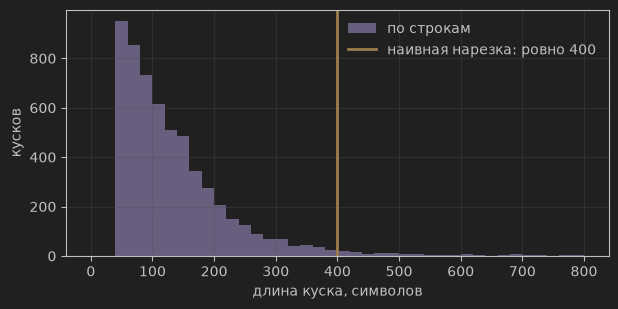
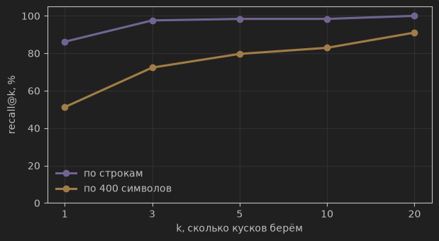
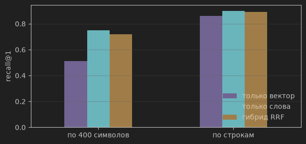

# Домашка 2 — RAG на корпусе событий 2026 года

Все числа ниже — из одного чистого прогона `hw2.ipynb` сверху вниз: 57 ячеек, ни одной
ошибки, выборка из 40 вопросов на каждый замер. Полная цена прогона — **0.171 USD**.

## Корпус

`fetch_corpus.py`: страниц 28, символов 845498, содержательных строк 5827.
Вопросов с цитатой, найденной в корпусе: **123 из 145** — остальные 22 отсеяны, потому что
их эталонная цитата в статьях Википедии не нашлась дословно.

Две нарезки:
- **наивная, по 400 символов** — 2121 кусок
- **осмысленная, по строкам** — 5751 кусок, заголовок раздела едет метаданными



## Нарезка и recall@k



| k | по строкам | по 400 символов |
| :--- | :--- | :--- |
| 1 | 0.86 | 0.51 |
| 3 | 0.98 | 0.72 |
| 5 | 0.98 | 0.80 |
| 10 | 0.98 | 0.83 |
| 20 | 1.00 | 0.91 |

Осмысленная нарезка обходит наивную на всех k, разница особенно заметна на recall@1
(0.86 против 0.51). Выбор **k = 5** для следующего шага обоснован тем, что на осмысленной
нарезке recall@5 уже 0.98 (практически максимум) — увеличивать k дальше означает платить
за лишние токены ради малого прироста recall. Свип по k это подтверждает: доля верных
ответов 0.80 при k=1, 0.90 при k=3 и ровно та же 0.90 при k=5 и k=10, а цена вопроса за
это время растёт с 0.00004 до 0.00010 USD.

## Гибридный поиск: вектор, слова, RRF



| нарезка | поиск | recall@1 | recall@5 |
| :--- | :--- | :--- | :--- |
| по 400 символов | только вектор | 0.51 | 0.80 |
| по 400 символов | только слова | 0.75 | 0.90 |
| по 400 символов | гибрид RRF | 0.72 | 0.89 |
| по строкам | только вектор | 0.86 | 0.98 |
| по строкам | только слова | 0.90 | 0.98 |
| по строкам | гибрид RRF | 0.89 | **1.00** |

На слабой (наивной) нарезке гибрид не панацея: чистый keyword-поиск (0.75) обходит и
вектор (0.51), и гибрид (0.72) — вопросы часто содержат точные даты и имена, которые
word-поиск ловит напрямую, а смешивание со слабым вектором немного портит результат.
На качественной (осмысленной) нарезке все три метода близки по recall@1, но гибрид RRF
даёт полное покрытие (1.00) уже на recall@5 — там, где чистые методы останавливаются
на 0.98. Вывод: RRF выигрывает не всегда сам по себе, а в первую очередь вместе
с хорошей нарезкой.

## Поиск: скорость и масштаб

Миллисекунд на запрос, k=5:

| векторов | numpy, перебор | Milvus, запрос на вызов | Milvus, пачкой |
| :--- | :--- | :--- | :--- |
| 5751 | 0.88 | 3.83 | 0.24 |
| 50000 | 8.42 | 7.54 | 0.76 |
| 200000 | 36.05 | 6.56 | 0.94 |

На нашем корпусе перебор в numpy быстрее Milvus: 0.88 мс против 3.83 — накладные расходы
на сетевой вызов больше самого поиска. Перелом наступает около 50 тысяч векторов, а на
200 тысячах numpy проигрывает уже в пять с половиной раз и деградирует линейно, тогда как
Milvus по индексу почти не растёт. Пачка запросов дешевле поштучных вызовов на порядок —
0.94 мс против 6.56.

## RAG-ответ, инструмент агента и замер

|  | config | model | n | accuracy | cost\_per\_task | cost\_per\_correct |
| :--- | :--- | :--- | :--- | :--- | :--- | :--- |
| 0 | сильная модель, без инструментов | claude-sonnet-4.6 | 40 | 0.025 | 0.00113 | 0.04525 |
| 1 | дешёвая модель, живой поиск hw1 | gpt-4o-mini | 40 | 0.525 | 0.00050 | 0.00096 |
| 2 | дешёвая модель, RAG всегда | gpt-4o-mini | 40 | 0.900 | 0.00007 | 0.00007 |
| 3 | дешёвая модель, агент+knowledge\_base | gpt-4o-mini | 40 | 0.850 | 0.00016 | 0.00018 |
| 4 | средняя модель, RAG всегда | claude-haiku-4.5 | 40 | 0.950 | 0.00065 | 0.00068 |

Главный тезис домашки подтверждается: **дешёвая модель с поиском бьёт сильную модель без
поиска** — 0.900 против 0.025, и верный ответ при этом стоит в 600 раз меньше (0.00007
против 0.04525 USD). Sonnet без инструментов не знает событий 2026 года и честно отвечает
NOT_FOUND; единственный зачтённый ответ из сорока — случайное попадание.

Локальная база знаний выигрывает у живого поиска по Википедии и по точности, и по цене:
0.900 против 0.525 при цене вопроса в семь раз ниже. Живой поиск здесь слабее даже
результата первой домашки на этой же выборке (0.625): у агента всего два инструмента
(`web_search`, `page_find`), и он часто тратит шаги на статьи не по теме.

Агент с `knowledge_base` (0.850) уступает безусловному RAG (0.900) и стоит вдвое дороже
по токенам: право решать, искать или нет, модель иногда тратит зря. Агент оправдан там,
где нужен выбор страницы или несколько уточняющих запросов, а не там, где поиск полезен
всегда. Переход на среднюю модель при том же RAG докидывает 0.05 точности (0.950) за
десятикратную цену — окупается только если ошибка дорога.

Разбор ошибок по RAG-конфигурациям: у всех трёх моделей ровно один случай, где поиск не
нашёл нужный кусок, остальные ошибки — в генерации (gpt-4o-mini 3, sonnet 2, haiku 1).
Значит узкое место уже не поиск.

## Таблица отказов

Десять вопросов без ответа в корпусе (`data/unanswerable_2026.jsonl`) против десяти
отвечаемых, агент с `knowledge_base`:

|  | честно отклонено из 10 безответных | зря отклонено из 10 отвечаемых |
| :--- | :--- | :--- |
| 0 | 10 | 2 |

Отказ работает, но охранитель настроен жёстко: все десять безответных вопросов отклонены
верно, ценой двух ложных отказов на отвечаемых. Причина видна по близости лучшего куска:
медиана 0.753 для вопросов с ответом в корпусе против 0.567 для вопросов без ответа —
распределения разделяются, но хвостами пересекаются, и вопросы из этого перехлёста модель
предпочитает отклонить. Отдельно `rag_answer` на тех же десяти безответных вопросах
отказал 10 из 10, без единой выдумки.

## Разбор двух провалов

**Провал 1: поиск не нашёл нужный кусок** (`fresh-2`, `found == False`)

Вопрос: *Who entered negotiations with the Trump administration on March 13, 2026?*
Эталон — `Miguel Díaz-Canel`, строка со страницы `2026 in politics`. Модель ответила
NOT_FOUND, и честно: в топ-5 эталона не было. Вектор вернул пять кусков со страницы
`2026 in the United States` про переговоры Трампа с Ираном (близость 0.624 … 0.571) —
семантически похоже, событие не то. В вопросе нет ни одного различающего слова: имя
ответа как раз и спрашивается, а единственная точная зацепка — дата `March 13`, которую
эмбеддинг кодирует слабо. Проверил отдельно: word-поиск ставит эталонный кусок на
**первое** место. То есть этот провал лечится именно гибридом RRF из предыдущего шага,
а не более сильной моделью.

**Провал 2: кусок найден, но ответ неверный** (`fresh-5`, `found == True`)

Вопрос: *How many people were killed in the car incident in Leipzig, Germany in May 2026?*
Поиск идеальный: лучший кусок с близостью 0.782 — ровно эталонная строка *4 May – A car
plows into a crowd in Grimmaische Strasse in Leipzig, killing two people and injuring 22
others*. Эталон — `two people`, модель ответила `2`. По сути ответ верный, но проверка
`is_correct` ищет эталон подстрокой: нормализация переводит `two` → `2`, и требуется
вхождение `2 people`, а не просто `2`. Это провал метрики, а не системы — и напоминание,
что строгое сравнение строк завышает долю ошибок.

## Долгая память

Факты о пользователе живут в отдельной коллекции Milvus и в файле `facts.json`, журнал
реплик — в `episodes.jsonl`. После первой сессии память знает: *имя Лена, город
Новосибирск, работа продуктовый аналитик, интересы космос и хоккей, отвечать коротко*.
Во второй сессии пользователь сообщает о переезде и смене интересов — и факты
**заменяются, а не дублируются**: город становится Калининградом, хоккей — футболом.
Три теста памяти без обращения к модели (пустая память, найденный факт, заменённый факт)
проходят, отдельная проверка после двух сессий подтверждает, что старого города в базе
не осталось.

Окно из четырёх последних реплик плюс факты против всей истории в контексте, десять
реплик диалога:

| режим | токенов на входе | цена, USD |
| :--- | :--- | :--- |
| окно + факты | 4789 | 0.00098 |
| вся история | 16012 | 0.00182 |

Память экономит 70% входных токенов и почти половину цены, не теряя знания
о пользователе: то, что важно, вынесено из контекста в базу.

## Как запустить

```bash
docker compose up -d
echo "OPENROUTER_API_KEY=..." > ../.env
jupyter lab hw2.ipynb
```

