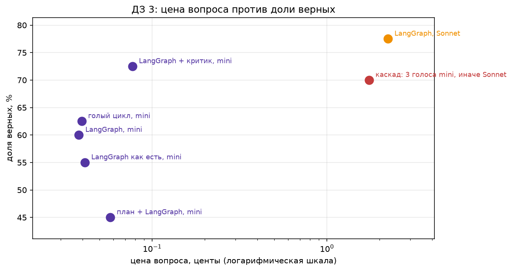

# ДЗ 3. Фреймворк, критик, голосование

Агент из первой домашки на 40 вопросах: `fresh-0` … `fresh-19` из стартового набора и все двадцать своих
русских `fresh-125` … `fresh-144` (`hw1/data/fresh_2026.jsonl`). Инструменты `web_search` и `page_find` с параметром `lang`:
свои вопросы о событиях русской Википедии. Модели: `openai/gpt-4o-mini` и `anthropic/claude-sonnet-4.6`. Фреймворк: LangGraph.
Запуск: `homework03.ipynb`, ключ `OPENROUTER_API_KEY` в `.env` или в секретах Colab, Run All. Прогон стоил $1.69
(все вызовы через один `httpx.Client` со счётчиком `usage.cost`, журнал в `results/calls.csv`).
Ответы каждой конфигурации на каждый вопрос: `results/answers.csv`.

Сбой при замере: в строке «LangGraph, Sonnet» 28 из 40 вызовов упали с `APIStatusError` у OpenRouter. Это сбой провайдера при
шести параллельных агентах (каскад и Sonnet шли одновременно), а не ответ модели. Ячейка «Проверки проверки» перезапрашивает только
упавшие вопросы, в два потока с паузой между попытками; после перезапроса ошибок 0. Упавшие вызовы денег не стоили и в счётчик не попали.

## Итог

| конфигурация | верно | доля | вызовов на вопрос | токенов на вопрос | центов на вопрос | центов за верный |
|---|---|---|---|---|---|---|
| голый цикл, mini | 25/40 | 0.625 | 3.9 | 2335 | 0.0395 | 0.0633 |
| LangGraph как есть, mini | 22/40 | 0.55 | 4.2 | 2604 | 0.0412 | 0.0749 |
| LangGraph, mini | 24/40 | 0.6 | 3.8 | 2292 | 0.0381 | 0.0635 |
| LangGraph + критик, mini | 29/40 | 0.725 | 7.0 | 4644 | 0.0772 | 0.1065 |
| каскад: 3 голоса mini, иначе Sonnet | 28/40 | 0.7 | 14.3 | 11291 | 1.7408 | 2.4869 |
| план + LangGraph, mini | 18/40 | 0.45 | 5.2 | 3387 | 0.0576 | 0.1281 |
| LangGraph, Sonnet | 31/40 | 0.775 | 4.2 | 6024 | 2.2357 | 2.8847 |

- Тезис подтвердился: лучшим по деньгам оказался критик на mini — 29/40 против 31/40 у Sonnet в одиночку при цене верного ответа 0.107 цента против 2.885, в 27 раз дешевле. Критик исправил 6 неверных ответов и испортил 1: на этой выборке он стоит своих денег, хотя вызовов на вопрос вдвое больше (7.0 против 3.8). Каскад дал 28/40, на 4 больше LangGraph на mini, но вопрос стоит 1.74 цента, в 46 раз дороже mini, а верный ответ всего на 14% дешевле, чем у Sonnet. Разница между 28, 29 и 31 из 40 лежит в пределах шума.
- Дорогое украшение: план — 18/40 против 24/40 без него при цене в 1.5 раза выше: план на событиях 2026 года строится вслепую и уводит поиск. Сам LangGraph ничего не добавил: 24/40 против 25/40 у голого цикла при той же цене. На своих 20 русских вопросах все конфигурации слабее, чем на английских (11–15 из 20): ответы стоят в новостях портала, а итоговые статьи часто ещё не дописаны.

## Налог фреймворка на пустом запросе

| исполнение | байт в первом запросе | токенов в первом вызове | вызовов всего |
|---|---|---|---|
| голый цикл | 1404 | 241 | 1 |
| LangGraph как есть | 1157 | 196 | 1 |
| LangGraph | 1432 | 247 | 1 |

Разница в первом вызове: **+6 токенов**. Голый цикл: 241 токенов и 1404 байт в первом запросе; LangGraph после починки: 247 токенов и 1432 байт. Перенос вслепую (196 токенов) легче, потому что tool(fn) молча выбросил описания аргументов, а граф обрывался по recursion_limit вместо ответа: 22/40 против 24/40 после починки. Польза фреймворка не в базовом цикле, а в том, что критик графом, лимит вызовов и остановка на подтверждение человеком пишутся в несколько строк.

## Критик и каскад

- Критик: исправил **6**, испортил **1**.
- Каскад: наверх ушло **30 из 40** (75%); цена верного ответа 2.4869 цента против 2.8847 у сильной модели.

## Проверка проверки

| конфигурация | сочтено неверными | прочитано | из них на самом деле верны | какие |
|---|---|---|---|---|
| голый цикл, mini | 17 | 17 | 2 | fresh-14, fresh-18 |
| LangGraph как есть, mini | 21 | 21 | 3 | fresh-5, fresh-7, fresh-10 |
| LangGraph, mini | 19 | 19 | 3 | fresh-5, fresh-10, fresh-18 |
| LangGraph + критик, mini | 18 | 18 | 7 | fresh-0, fresh-4, fresh-5, fresh-8, fresh-10, fresh-14, fresh-18 |
| каскад: 3 голоса mini, иначе Sonnet | 15 | 15 | 3 | fresh-125, fresh-126, fresh-136 |
| план + LangGraph, mini | 24 | 24 | 2 | fresh-7, fresh-14 |
| LangGraph, Sonnet | 12 | 12 | 3 | fresh-125, fresh-126, fresh-136 |

Прочитаны все ответы, которые проверка сочла неверными, во всех конфигурациях. Главная находка — ошибка формы, которую внёс я сам: в системный промпт добавлено «на вопросы по-русски отвечай по-русски», и mini стал отвечать по-русски и на английские вопросы («15 марта», «два человека», «двенадцать», «13 июля», «Павлу Дурову», «Сьюдад-Родриго»). Проверка сравнивает с английским эталоном и такие ответы не засчитывает. Sonnet в каскаде, наоборот, даёт английские названия русских эталонов («The Pitt», «Widow's Bay»). Такие ответы засчитаны по списку в check_manual.json, код проверки не менялся. Под подозрением, но не засчитаны: fresh-6 (эталон 4,500, все отвечают 519 пропавших) и fresh-144 (76 в ленте на дату вопроса, 77 в нынешней английской Википедии). В «LangGraph как есть» 11 из 21 неверного — GraphRecursionError, а не ошибки модели.

## Потолок на деньги

Лимит в два вызова модели (`ModelCallLimitMiddleware`):

|  | значение |
|---|---|
| вопрос | On what date did Ukraine boycott the closing ceremony of the 2026 Winter Paralympics? |
| ответ LangGraph после обрыва | Model call limits exceeded: run limit (2/2) |
| вызовов модели | 2 |
| ответ голого цикла при max_steps=2 | Ukraine boycotted the closing ceremony of the 2026 Winter Paralympics on March 15, 2026. |
| эталон | 15 March |
