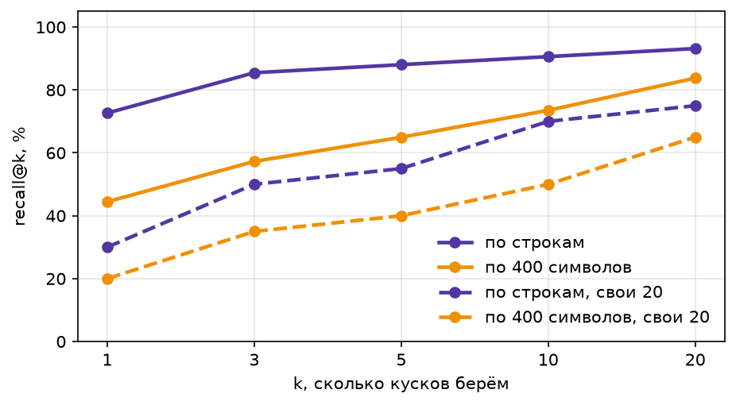
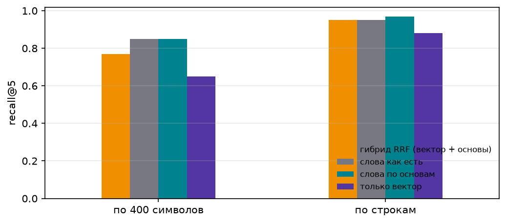
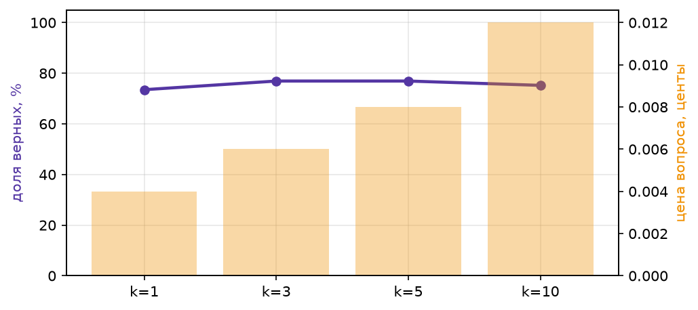
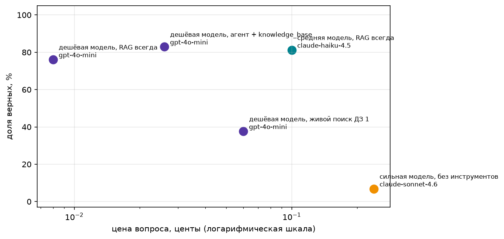
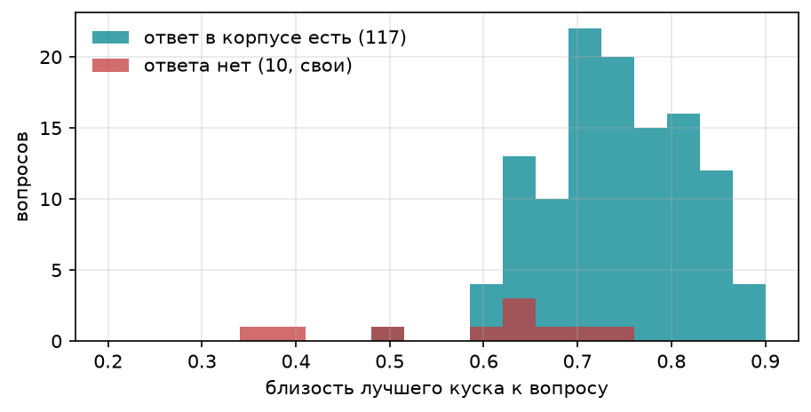
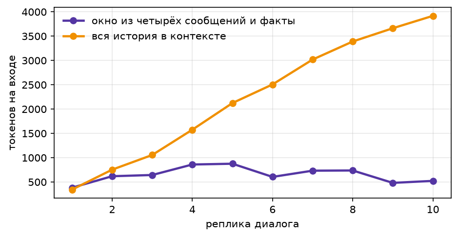

# ДЗ 4. RAG на своём корпусе: переделка ДЗ 2 по фидбеку

Все числа ниже взяты из одного прогона `hw4.ipynb` сверху вниз: 49 ячеек, ошибок нет, **все 117 вопросов** в каждом замере.
Последняя ячейка ноутбука печатает журнал вызовов, после неё вызовов нет. Полная цена прогона: **0.556 USD**.

## Что исправлено по фидбеку

Список с пунктами фидбека ДЗ 2 и ДЗ 3 и ссылками на коммиты — в корневом [README.md](../README.md#что-исправлено-по-фидбеку) итогового агента.

## Корпус и вопросы

- `fetch_corpus_ru.py`: 20 страниц, 193 564 символа.
  - 9 правок (`oldid`) ленты «Последние события» и новостей заглавной страницы, из которых взяты свои вопросы. Правки одной ленты склеены без повторов строк, документация шаблона вырезана.
  - Тематические статьи: «Эмми» 2026, 83-й Венецианский кинофестиваль, US Open 2026 (общая и два одиночных разряда), ЧМ по баскетболу среди женщин, выборы в Швеции, Leopardus tilcayo, Хашим Тачи.
  - Хроники: «Август/Сентябрь/Октябрь 2026 года», «2026 год», «2026 год в науке», «2026 год в спорте».
  - Отвлекающие: «Эмми» 2025, 82-й Венецианский кинофестиваль, выборы в Швеции 2022: похожие формулировки, другой год.
- `make_questions.py`: 117 вопросов (20 своих + 97 по корпусу). Вопросы по корпусу взяты только со страниц о 2026 годе: про прошлые годы сильная модель знает ответ и без поиска.
- `data/unanswerable_ru.jsonl`: 10 своих вопросов без ответа, рядом с темами корпуса (Канны 2026, MVP чемпионата по баскетболу, рекорд оваций на 83-й Венеции, который есть только у 82-й, и т. д.).

## Нарезка и recall@k



| k | по строкам | по 400 символов | по строкам, свои 20 | по 400 символов, свои 20 |
| :--- | :--- | :--- | :--- | :--- |
| 1 | 0.73 | 0.44 | 0.30 | 0.20 |
| 3 | 0.85 | 0.57 | 0.50 | 0.35 |
| 5 | 0.88 | 0.65 | 0.55 | 0.40 |
| 10 | 0.91 | 0.74 | 0.70 | 0.50 |
| 20 | 0.93 | 0.84 | 0.75 | 0.65 |

Нарезка по строкам обходит наивную на всех k. Свои 20 вопросов заметно труднее. Их факты в корпусе повторяются в
тематических статьях («Золотой лев» есть и в ленте, и в статье о фестивале), а эталон засчитывается только на странице
цитаты. Главное же, что в таблицах статей много коротких строк-заголовков вроде «Чемпионат мира по баскетболу среди
женщин 2026», и эмбеддинг ставит их выше строки новости (см. провал 1).

## Milvus

- Совпадение топ-5 у Milvus и перебора в numpy: **1.0** на всех 117 вопросах.
- Фильтр по странице: `page == "83-й Венецианский кинофестиваль"` по запросу «лучший сценарий» отдаёт пять кусков только с этой страницы.
- Прогон шёл на Milvus Lite (файл вместо Docker-сервера), поэтому скорость не сравнима с сервером из ДЗ 2.

Миллисекунд на запрос, k = 5:

| векторов | numpy, перебор | Milvus Lite, запрос на вызов | Milvus Lite, пачкой |
| :--- | :--- | :--- | :--- |
| 1 274 | 0.37 | 8.86 | 1.72 |
| 50 000 | 12.39 | 150.88 | 3.34 |
| 200 000 | 62.38 | 274.70 | 7.17 |

numpy растёт линейно: 0.37 → 62 мс. Milvus Lite поштучными вызовами медленнее перебора на любом размере, потому что каждый
вызов идёт через gRPC внутри процесса. Пачкой он обгоняет numpy уже на 50 тысячах векторов (3.3 мс против 12.4) и на
200 тысячах выигрывает почти в 9 раз.

## Гибрид: вектор, слова, RRF



| нарезка | поиск | recall@1 | recall@5 | recall@10 |
| :--- | :--- | :--- | :--- | :--- |
| по 400 символов | только вектор | 0.44 | 0.65 | 0.74 |
| по 400 символов | слова как есть | 0.70 | 0.85 | 0.89 |
| по 400 символов | слова по основам | 0.73 | 0.85 | 0.91 |
| по 400 символов | гибрид RRF (вектор + основы) | 0.52 | 0.77 | 0.88 |
| по строкам | только вектор | 0.73 | 0.88 | 0.91 |
| по строкам | слова как есть | 0.82 | 0.95 | 0.95 |
| по строкам | слова по основам | 0.83 | **0.97** | 0.97 |
| по строкам | гибрид RRF (вектор + основы) | 0.79 | 0.95 | **0.98** |

На русском корпусе словарный поиск сильнее вектора: в вопросах есть точные имена, номера и названия. Основы слов
(«Франции» = «Франция») добавляют немного: 0.95 → 0.97 на recall@5. Гибрид RRF лучший только на recall@10 (0.98). На
recall@1 и recall@5 слабый вектор тянет его вниз, особенно на наивной нарезке (0.52 против 0.73 у слов). Итог по этому
корпусу: гибрид не панацея, словарный поиск по основам на нарезке по строкам почти не уступает ему и дешевле.

## Выбор k



| k | доля верных, gpt-4o-mini | цена вопроса, USD |
| :--- | :--- | :--- |
| 1 | 0.735 | 0.00004 |
| 3 | 0.769 | 0.00006 |
| 5 | 0.769 | 0.00008 |
| 10 | 0.752 | 0.00012 |

k = 3 и k = 5 дают одинаковую долю верных. k = 10 хуже: в контекст попадают похожие строки с других страниц, и модель
путается. Для замера оставил k = 5: recall@5 выше recall@3 (0.88 против 0.85), а разница в цене 0.00002 USD на вопрос.

## Пять строк на всех 117 вопросах



|  | конфигурация | модель | n | доля верных | цена вопроса, USD | цена верного, USD |
| :--- | :--- | :--- | :--- | :--- | :--- | :--- |
| 0 | сильная модель, без инструментов | claude-sonnet-4.6 | 117 | 0.068 | 0.00239 | 0.03501 |
| 1 | дешёвая модель, живой поиск ДЗ 1 | gpt-4o-mini | 117 | 0.376 | 0.00060 | 0.00161 |
| 2 | дешёвая модель, RAG всегда | gpt-4o-mini | 117 | 0.761 | 0.00008 | 0.00011 |
| 3 | дешёвая модель, агент + knowledge_base | gpt-4o-mini | 117 | 0.829 | 0.00026 | 0.00031 |
| 4 | средняя модель, RAG всегда | claude-haiku-4.5 | 117 | 0.812 | 0.00100 | 0.00123 |

Отдельно по своим 20 вопросам и по 97 вопросам по корпусу:

| конфигурация | свои 20 | по корпусу 97 |
| :--- | :--- | :--- |
| сильная модель, без инструментов | 0.00 | 0.082 |
| дешёвая модель, живой поиск ДЗ 1 | **0.75** | 0.299 |
| дешёвая модель, RAG всегда | 0.45 | 0.825 |
| дешёвая модель, агент + knowledge_base | 0.60 | **0.876** |
| средняя модель, RAG всегда | 0.55 | 0.866 |

Агент ДЗ 1 с живым поиском на своих 20 вопросах в ДЗ 1 не ответил ни на один (поле `agent_ok` в `hw1/data/fresh_2026.jsonl`
равно 0 у всех двадцати). Тогда у него не было русской Википедии и параметра `lang`.

### Проверка проверки

Прочитаны все неверные ответы, где модель не отказалась (у Sonnet все 20, у остальных конфигураций все). Нашлись ошибки проверки:
- ударение в эталоне «тилька́йо»;
- «1,4 млн» против «1,4 миллиона»;
- «четырежды» против «4 раза»;
- «третий» против «3-й»;
- «146-й» против «146-м»;
- «три попытки» против «3»;
- «универсальному закону» против «универсальный закон»: основа «минус две буквы» коротка для длинных окончаний;
- fresh-129: «Специализированные палаты по Косову» — официальное название того же Специального суда.

У живого поиска ещё два ответа согласуются с эталоном, но взяты из нынешней Википедии: 357 погибших при эталоне «более
300» и рост госдолга в 2,02 раза при эталоне «2 раза». Код проверки после прогона не менял, чтобы ноутбук и числа
совпадали. Поправки ниже:

| конфигурация | по проверке | верны на самом деле | доля после чтения |
| :--- | :--- | :--- | :--- |
| сильная модель, без инструментов | 8 | +3 | 0.094 |
| дешёвая модель, живой поиск ДЗ 1 | 44 | +6 | 0.427 |
| дешёвая модель, RAG всегда | 89 | +5 | 0.803 |
| дешёвая модель, агент + knowledge_base | 97 | +5 | 0.872 |
| средняя модель, RAG всегда | 95 | +3 | 0.838 |

Порядок конфигураций не меняется.

### Вывод по тезису

**Дешёвая модель с поиском бьёт сильную без поиска, и с запасом:** 0.761 у gpt-4o-mini с RAG против 0.068 у Sonnet.
Верный ответ при этом стоит в 300 раз меньше (0.00011 против 0.035 USD). После чтения ответов 0.803 против 0.094. Sonnet
без инструментов попадает только туда, где факт угадывается из прошлых лет: 349 мест в риксдаге, уходящий премьер
Кристерссон, дата выборов в Сенат США. На своих 20 вопросах у Sonnet ноль.

- **Локальная база против живого поиска.** На всём наборе база сильнее и дешевле: 0.761 против 0.376 при цене вопроса в
  7 раз ниже. На своих 20 вопросах наоборот: живой поиск 0.75, RAG 0.45. Живой агент находит в нынешней Википедии
  итоговые статьи, где ответ стоит в первом абзаце. RAG по своему корпусу на этих вопросах чаще упирается в поиск (провал 1).
- **Агент с `knowledge_base` лучший из дешёвых:** 0.829 против 0.761 у безусловного RAG при цене в 3 раза выше. В отличие
  от ДЗ 2, где агент проигрывал, здесь ему помогают переформулировка запроса и фильтр по странице: на своих 20 вопросах
  0.60 против 0.45.
- **Средняя модель с тем же RAG:** +0.05 к точности (0.812) за двенадцатикратную цену. Haiku реже отказывается при
  найденном куске.
- **Где узкое место.** У gpt-4o-mini с RAG 28 неверных: 13 раз нужного куска не было в топ-5, 15 раз кусок был. Из этих
  15 пять — ошибки проверки, восемь — отказ NOT_FOUND при найденном куске, и только два — неверное число (gen-85,
  gen-87). Поэтому две задачи примерно поровну: поиск на своих вопросах и излишняя осторожность дешёвой модели при
  генерации. Слова «узкое место уже не поиск» здесь неверны.

## Разбор двух провалов

**Провал 1: поиск не нашёл кусок** (fresh-133, `found == False` у обеих RAG-конфигураций).
Вопрос: *Сборная какой страны выиграла чемпионат мира по баскетболу среди женщин 2026 года?* Эталон «США». Строка-цитата
«Чемпионат мира по баскетболу среди женщин в пятый раз подряд выиграла сборная США…» стоит в векторной выдаче на
**107-м месте**. Наверху строки из статьи о чемпионате:
1. заголовок «Чемпионат мира по баскетболу среди женщин 2026» (близость 0.833, дважды);
2. «11 сборных отберутся через квалификационный отборочный турнир»;
3. шапки таблиц «Турнир Дата Место проведения Места Команды» и «Квалификационный раунд | Четвертьфинал | Полуфинал | Финал».

Вопрос почти дословно повторяет название статьи, а эмбеддинг меряет похожесть формулировки, а не наличие ответа.
Словарный поиск по основам на этом же вопросе ставит эталон **на 1-е место**: редкое «выиграла» весит больше, чем слова
названия, которые есть в сотне строк. Значит, лечится гибридом или словарным поиском (в ноутбуке RAG идёт только по
вектору) и чисткой корпуса от строк-заголовков и шапок таблиц.

**Провал 2: кусок найден, ответ неверный** (fresh-125, `found == True`).
Вопрос: *Какой сериал был признан лучшим драматическим сериалом на 78-й церемонии вручения премии «Эмми» в 2026 году?*
Нужная строка первая в выдаче: «Состоялась 78-я церемония вручения премии «Эмми»: лучшим драматическим сериалом был признан
«Больница Питт»…». gpt-4o-mini отвечает `NOT_FOUND`. В строке нет «2026 года», и модель не решается связать «78-ю
церемонию» с годом из вопроса. Haiku с теми же пятью кусками отвечает «Больница Питт». Тот же провал на fresh-127 из той
же строки. Это ошибка генерации, а не проверки. Лечится промптом («год может не стоять в источнике, если событие
опознаётся по номеру») или средней моделью.

## Отказы на своих десяти вопросах без ответа

|  | честно отклонено из 10 безответных | зря отклонено из 117 отвечаемых | выдумки |
| :--- | :--- | :--- | :--- |
| RAG всегда, gpt-4o-mini | 10 | 21 | — |
| агент + knowledge_base, gpt-4o-mini | 9 | 7 | «23 минуты 50 секунд» |



Безусловный RAG отказывается на всех десяти, но жёстко: 21 ложный отказ на отвечаемых. Агент отказывается реже зря (7),
зато попался в ловушку из ловушек: на вопрос о рекорде оваций на **83-м** Венецианском фестивале он ответил рекордом
**82-го** со страницы-отвлекающей. Медиана близости лучшего куска 0.744 для вопросов с ответом против 0.633 для своих
десяти без ответа, на одних и тех же файлах. Хвосты распределений пересекаются, поэтому порога по близости мало.

## Долгая память

Свой диалог. После первой сессии память знает: *Артём, Казань, кинокритик, интересы кино и теннис, отвечать подробно и
называть режиссёров*. Во второй сессии пользователь бросает теннис ради баскетбола и переезжает. Факты **заменяются, а не
дублируются**: город Санкт-Петербург, интересы кино и баскетбол, Казани в базе нет (проверка в ноутбуке). Три теста памяти
без модели (пустая память, найденный факт, заменённый факт) проходят.

Честная оговорка: на вопрос «Кто выиграл женский чемпионат мира по баскетболу 2026 года?» во второй сессии ассистент
ответа не нашёл. Это тот же провал поиска, что fresh-133.

Окно из четырёх реплик и факты против всей истории в контексте, десять своих вопросов подряд:



| режим | токенов на входе | цена, USD |
| :--- | :--- | :--- |
| окно + факты | 6 462 | 0.00128 |
| вся история | 22 351 | 0.00252 |

Память экономит 71% входных токенов и половину цены.

## Файлы

- `fetch_corpus_ru.py`, `make_questions.py`: сборка корпуса и вопросов. `data/questions_generated_raw.jsonl`: сырые вопросы модели до отбраковки.
- `hw4.ipynb`: все замеры. `results/answers_full.csv`: ответ каждой конфигурации на каждый вопрос.
- `wiki_cache.json`: ответы Википедии для живого поиска. Без него повторный прогон упирается в лимит частоты (429).

## Как запустить

```bash
pip install -r ../requirements.txt
cp ../.env.example ../.env          # вписать OPENROUTER_API_KEY
# Milvus: сервер из hw2 (docker compose up -d) или файл Milvus Lite
pip install milvus-lite              # на Windows ставится отдельно, в pymilvus[milvus_lite] его нет
HW4_MILVUS_URI=./milvus_hw4.db jupyter lab hw4.ipynb
```
